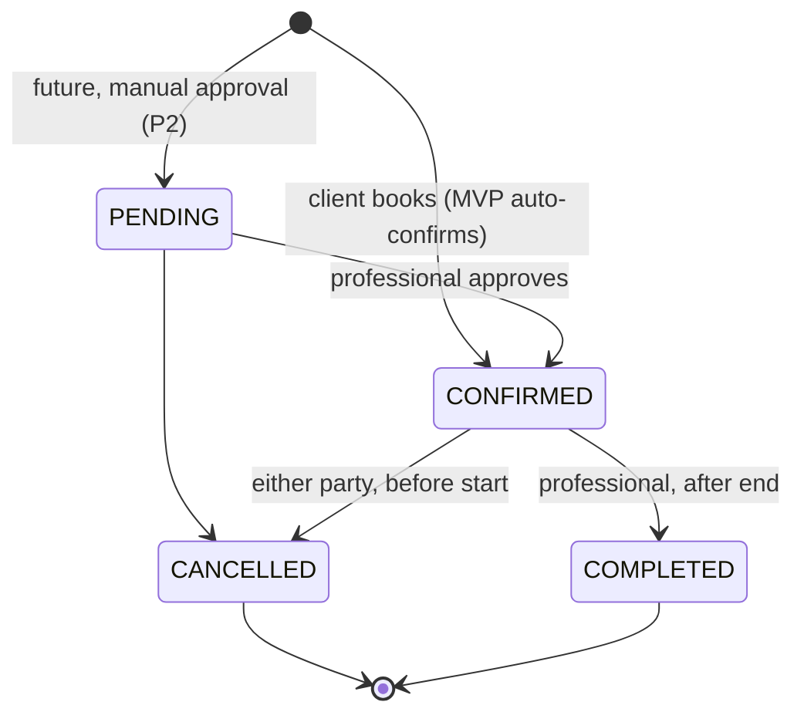
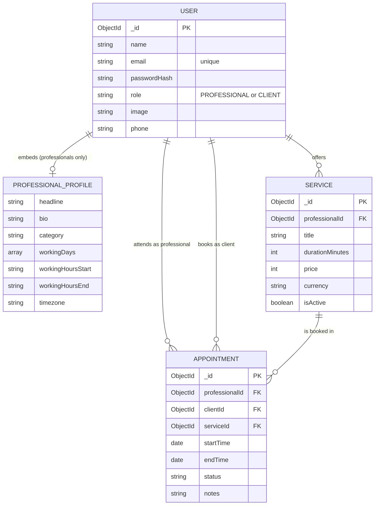
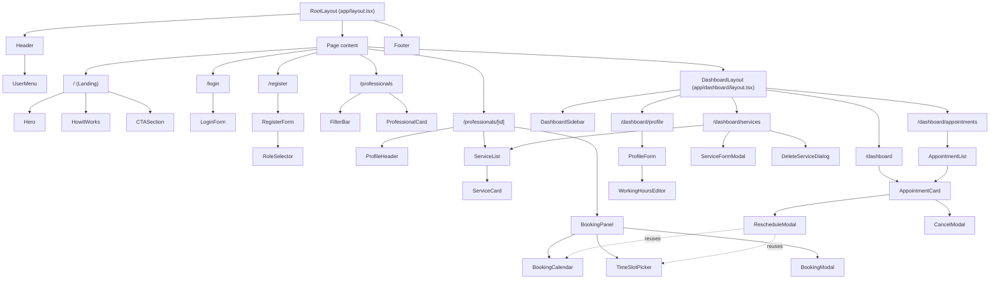

# Viable Appointment Scheduler — Project Specification

> **Status:** Ready for implementation · **Version:** 1.0 · **Last updated:** 2026-11-11
> **Team:** Sthephani Platero · Anisa Chokwenda · Habyarimana Cassien · **Timeline:** 3 weeks (Week 04 → Week 06)
> Task breakdown per issue lives in [ISSUES.md](./ISSUES.md).

## Table of Contents
1. [Project Title & Description](#1-project-title--description)
2. [Purpose & Target Audience](#2-purpose--target-audience)
3. [MVP Scope](#3-mvp-scope)
4. [User Stories](#4-user-stories)
5. [Acceptance Criteria](#5-acceptance-criteria)
6. [Business Rules](#6-business-rules)
7. [Technical Requirements](#7-technical-requirements)
8. [Design Theme & Branding](#8-design-theme--branding)
9. [Data Model](#9-data-model)
10. [Core API Endpoints](#10-core-api-endpoints)
11. [Component Architecture](#11-component-architecture)
12. [Implementation Priority](#12-implementation-priority)
13. [Team Conventions & Definition of Done](#13-team-conventions--definition-of-done)

---

## 1. Project Title & Description
**Viable Appointment Scheduler** ("Viable") is a clean, accessible booking platform for independent solo professionals (tutors, therapists, consultants, coaches) and their clients. Professionals create a public profile, set their working hours, and manage their services. Clients discover professionals, browse services, check real-time availability, and book appointments in seconds.

The project solves a real problem in emerging markets: solo entrepreneurs lose clients and waste hours juggling bookings by hand through WhatsApp messages, phone calls, and paper notebooks. The MVP covers the core booking, profile management, and appointment tracking workflows.

## 2. Purpose & Target Audience
- **Target audience:**
  - **Solo professionals & service providers:** independent tutors, consultants, fitness trainers, and therapists who need a simple, professional booking presence without enterprise-software complexity.
  - **Clients & students:** people who want to see service offerings, check availability, and book or manage appointments with immediate confirmation.
- **Purpose:** modernize appointment scheduling for micro-businesses by replacing manual WhatsApp/phone coordination with an automated web booking system that prevents double-booking and missed appointments.

## 3. MVP Scope

| In scope (MVP) | Out of scope (future, see P2) |
| :--- | :--- |
| Email/password accounts with two roles: `PROFESSIONAL` and `CLIENT` | Social login (Google, etc.) |
| Professional public profile with working days/hours | Profile verification badges |
| Services CRUD (title, description, duration, price in USD or KES) | Online payments (Stripe / M-Pesa / EcoCash) |
| Real-time availability and instant booking (auto-confirmed) | Manual approval of bookings by the professional |
| Dashboard: view, reschedule, cancel, and complete appointments | Email/SMS/WhatsApp notifications and reminders |
| Browse/search professionals by name and category | Reviews and ratings |
| Responsive UI (mobile → desktop), accessible (WCAG 2.1 AA) | Google Calendar sync, `.ics` export |
| | **Video calls / meeting links (not planned)** |

> **Viable only schedules appointments.** It records who, which service, and when. It does not host or link video calls. The place of the session (the professional's `location`, or whatever both parties agree) is handled outside the app.

## 4. User Stories
1. **US1 — Account & sign-in:** As a user (professional or client), I want to create an account and log in securely so that I can access my personalized dashboard and manage my bookings.
2. **US2 — Manage services:** As a professional, I want to create, edit, and delete services (title, duration, price, description) so that prospective clients know exactly what I offer.
3. **US3 — Public profile:** As a professional, I want to set up my public profile (bio, working days/hours, contact details) so that clients can learn about my qualifications and schedule.
4. **US4 — Discover & check availability:** As a client, I want to find a professional and view their available dates and time slots so that I can choose a time that fits my schedule.
5. **US5 — Book:** As a client, I want to book an appointment for a specific service so that the time slot is reserved and recorded in the system.
6. **US6 — View appointments:** As a professional or client, I want to view my upcoming and past appointments on a dashboard so that I can keep track of my schedule.
7. **US7 — Reschedule & cancel:** As a client or professional, I want to reschedule or cancel an existing appointment so that the change shows on both dashboards and the old slot is freed up.

## 5. Acceptance Criteria

### US1 — Account & sign-in
- **Given** a visitor on `/register`, **when** they submit a valid name, email, password (min. 8 characters), and role, **then** the account is created, they are signed in with Auth.js, and redirected to `/dashboard`.
- **Given** an email that is already registered or an invalid password, **when** registration is attempted, **then** a clear inline error is shown and the form keeps the user's input (except the password).
- **Given** a registered user on `/login`, **when** they submit correct credentials, **then** they are redirected to `/dashboard`; **when** credentials are wrong, **then** a generic "Invalid email or password" message is shown.
- **Given** a signed-out visitor, **when** they open any `/dashboard/*` route, **then** they are redirected to `/login`.

### US2 — Manage services
- **Given** a signed-in professional on `/dashboard/services`, **when** they submit the "Add Service" form with title, duration, price, currency, and description, **then** the service is saved and appears in the list immediately.
- **Given** an existing service, **when** the professional edits it, **then** the changes are saved and shown on their public profile; **when** they delete it, **then** it is removed, or archived (`isActive: false`) if any appointment references it.
- **Given** an incomplete form (e.g. missing price or duration), **when** submitted, **then** the required fields are highlighted and nothing is saved.
- **Given** a client, or a professional who does not own the service, **when** they try to edit or delete it, **then** the API returns `403 Forbidden`.

### US3 — Public profile
- **Given** a signed-in professional on `/dashboard/profile`, **when** they save headline, bio, category, phone, location, working days, and working hours, **then** the data is saved and shown on `/professionals/[id]`.
- **Given** working hours where the end time is not after the start time, **when** saved, **then** a validation error is shown.
- **Given** any visitor on `/professionals/[id]`, **when** the page loads, **then** they see the professional's avatar, name, headline, bio, contact info, and active services.
- **Given** an id that doesn't exist or belongs to a client, **when** the page loads, **then** the "not found" page is shown.

### US4 — Discover & check availability
- **Given** any visitor on `/professionals`, **when** they type a name or choose a category, **then** the list shows only matching professionals, with an empty state when there are none.
- **Given** a visitor on a professional's profile who has selected a service and a date, **when** the date is chosen, **then** only slots that follow the [availability rules](#61-availability-rules) are shown.
- **Given** a non-working day, a fully booked day, or a past date, **when** selected, **then** a friendly empty state says no slots are available and suggests picking another date.

### US5 — Book
- **Given** a signed-in client who picked a service, date, and open slot, **when** they confirm the booking (with optional notes), **then** the appointment is saved with status `CONFIRMED` and the slot no longer appears as available.
- **Given** a signed-out visitor, **when** they try to book, **then** they are sent to `/login` and returned to the profile page afterwards.
- **Given** two clients booking overlapping times with the same professional at the same moment, **when** the second request is processed, **then** it is rejected with `409 Conflict` and the client is asked to pick another time.
- **Given** a signed-in professional, **when** they view a profile, **then** booking controls are disabled (only clients can book).

### US6 — View appointments
- **Given** a signed-in user on `/dashboard/appointments`, **when** the page loads, **then** they see their appointments in **Upcoming**, **Past**, and **Cancelled** tabs (see [status rules](#62-appointment-status-lifecycle)), sorted by date, each with a status badge.
- **Given** a professional, **then** they see all appointments booked with them; **given** a client, **then** they see only their own.
- **Given** a tab with no appointments, **then** an empty state with a call to action is shown ("Browse professionals" for clients, "Share your profile" for professionals).

### US7 — Reschedule & cancel
- **Given** an upcoming appointment, **when** the client or professional chooses "Reschedule" and picks a new open slot, **then** `startTime`/`endTime` are updated and the old slot becomes available again.
- **Given** an upcoming appointment, **when** either party chooses "Cancel" and confirms in the modal (optional reason), **then** the status becomes `CANCELLED`, `cancelledAt` is recorded, and the slot becomes available again.
- **Given** a past, completed, or cancelled appointment, **then** the Reschedule and Cancel actions are not available.
- **Given** a past `CONFIRMED` appointment, **when** the professional chooses "Mark as completed", **then** the status becomes `COMPLETED`.

## 6. Business Rules

### 6.1 Availability rules
A time slot is shown as **available** only if all of these are true:
1. The date is one of the professional's `workingDays` and is between today and **60 days** ahead.
2. Slots start at `workingHoursStart` and repeat every `durationMinutes` of the selected service. A slot must **end** at or before `workingHoursEnd`.
3. The slot starts in the future (slots for today that have already started are hidden).
4. The slot does not overlap any `PENDING` or `CONFIRMED` appointment of that professional. Two time ranges overlap when `existing.startTime < new.endTime && existing.endTime > new.startTime`.

**Time zones:** slots are calculated and displayed in the **professional's `timezone`** (the page shows the time zone label). All dates are stored in **UTC**.

### 6.2 Appointment status lifecycle



| Dashboard tab | Rule |
| :--- | :--- |
| **Upcoming** | status `PENDING` or `CONFIRMED` **and** `startTime ≥ now` |
| **Past** | status `COMPLETED`, **or** status `CONFIRMED` with `startTime < now` |
| **Cancelled** | status `CANCELLED` |

- Rescheduling and cancelling are only allowed **before** `startTime`.
- A cancelled appointment is never deleted; it stays for history.

### 6.3 Permissions

| Action | Visitor | Client | Professional |
| :--- | :---: | :---: | :---: |
| Browse professionals & view profiles/services | ✅ | ✅ | ✅ |
| Book an appointment | ➡️ login | ✅ | ❌ |
| Create / edit / delete services | ❌ | ❌ | ✅ own only |
| Edit public profile & working hours | ❌ | ❌ | ✅ own only |
| View appointments | ❌ | ✅ own | ✅ own |
| Reschedule / cancel | ❌ | ✅ own | ✅ own |
| Mark as completed | ❌ | ❌ | ✅ own |

Permissions are enforced **on the server** (Route Handlers / Server Actions). Hiding a button in the UI is never the only protection.

## 7. Technical Requirements

### 7.1 Stack

| Area | Choice |
| :--- | :--- |
| Framework | **Next.js 16** (App Router) + **React 19** |
| Language | **TypeScript**, strict mode, no `any` |
| Styling | **Tailwind CSS v4** with design tokens in `app/globals.css` (`@theme`) |
| Database | **MongoDB Atlas** (free M0 cluster) via **Mongoose** |
| Authentication | **Auth.js v5** (`next-auth@beta`), **Credentials** provider (email + password), **JWT session strategy** (no database adapter); the session exposes `user.id` and `user.role` |
| Route protection | `proxy.ts` at the project root (Next.js 16 renamed `middleware.ts` to `proxy.ts`) redirects signed-out users away from `/dashboard/*`; every Route Handler also checks the session |
| Validation | **Zod** schemas shared by forms and API (`lib/validations/`) + **React Hook Form** (`@hookform/resolvers/zod`) |
| Passwords | **bcryptjs** (salt rounds: 10) |
| Dates & time zones | **date-fns** + **@date-fns/tz** |
| UI primitives | **Radix UI** primitives (via shadcn/ui patterns) for Dialog, Tabs, Popover; **lucide-react** icons |
| Testing | **Vitest** unit tests for business logic (`lib/availability.ts`, `lib/money.ts`); each Pull Request is tested manually against the acceptance criteria in §5 |
| Hosting | **Vercel** (app) + **MongoDB Atlas** (database) |

### 7.2 Architecture rules
- **Server Components by default** for data fetching and SEO. Use Client Components (`'use client'`) only for interactive pieces: forms, calendar, time-slot picker, modals, tabs.
- The database is accessed **only on the server** (Server Components, Route Handlers, Server Actions) through the cached connection helper `lib/db.ts`. It is never imported into Client Components.
- In Next.js 16, `params` and `searchParams` in pages and route handlers are **Promises** and must be `await`ed.
- **API response format** (`lib/api-response.ts`):
  - Success: `{ "data": ... }` with `200` / `201`
  - Error: `{ "error": { "code": "VALIDATION_ERROR", "message": "...", "fields"?: {...} } }` with `400` (validation), `401` (not signed in), `403` (not allowed), `404` (not found), `409` (slot conflict / email taken), `500`.
- Prices are stored as **integers in the minor unit** (cents). Forms accept decimals and convert them; the UI formats with `Intl.NumberFormat`.

### 7.3 Environment variables
Kept in `.env.local` (never committed). A `.env.example` with empty values is committed.

| Variable | Purpose |
| :--- | :--- |
| `MONGODB_URI` | Atlas connection string (includes the database name `viable`) |
| `AUTH_SECRET` | Auth.js secret; generate with `npx auth secret` |
| `AUTH_URL` | Only needed outside Vercel, e.g. `http://localhost:3000` |

### 7.4 Folder structure

```text
app/
  (auth)/login/page.tsx
  (auth)/register/page.tsx
  professionals/page.tsx
  professionals/[id]/page.tsx
  professionals/[id]/book/success/page.tsx
  dashboard/layout.tsx            # sidebar + session check
  dashboard/page.tsx
  dashboard/appointments/page.tsx
  dashboard/services/page.tsx
  dashboard/profile/page.tsx
  api/auth/[...nextauth]/route.ts
  api/auth/register/route.ts
  api/professionals/...           # see section 10
  api/services/...
  api/appointments/...
  layout.tsx  page.tsx  globals.css  not-found.tsx
components/
  layout/  ui/  auth/  landing/  professionals/  services/  booking/  appointments/
lib/
  db.ts  auth.ts  api-response.ts  availability.ts  money.ts  validations/
models/
  User.ts  Service.ts  Appointment.ts
types/
  next-auth.d.ts                  # adds id and role to the session type
scripts/
  seed.mjs
proxy.ts
```

## 8. Design Theme & Branding

### 8.1 Visual design language & philosophy
Viable's visual identity follows the principle **"Calm Commerce & Reassurance"**:
- **Trust and professionalism:** replaces the friction of booking by hand over WhatsApp with a polished, structured look with no visual noise.
- **Warmth and approachability:** balances the seriousness of professional services with warm tones and friendly details, so clients don't feel intimidated when booking.
- **Clear information:** strict visual hierarchy for dates, times, and prices in multiple currencies (USD / KES).

### 8.2 Color palette

| Role / Token | HEX | Name | Usage |
| :--- | :--- | :--- | :--- |
| **Primary** `--color-brand` | `#0F766E` | Deep Teal 700 | Brand identity, active navigation, primary buttons in the professional dashboard, focus rings, active states. Conveys stability and calm professionalism. |
| **Secondary / CTA** `--color-accent` | `#F59E0B` | Warm Amber 500 | Key conversion buttons ("Confirm Booking", "Save Changes", "+ Add Service"). Gives instant contrast and guides the next action. |
| **Surface base** `--color-surface` | `#F8FAFC` | Slate 50 | Page background; less eye strain than pure white. |
| **Surface container** `--color-card` | `#FFFFFF` | White | Cards, modals, forms, and floating panels. |
| **Text primary** `--color-ink` | `#0F172A` | Slate 900 | Titles, H1–H3, and key numbers. |
| **Text muted** `--color-muted` | `#64748B` | Slate 500 | Helper labels, secondary descriptions, metadata (time zones, character counts). |
| **Success** `--color-success` | `#10B981` (fill) / `#047857` (text) | Emerald 500 / 700 | Confirmed bookings, "Accepting bookings", active states. |
| **Warning** `--color-warning` | `#D97706` (fill) / `#B45309` (text) | Amber 600 / 700 | Pending confirmation, upcoming-policy notices. |
| **Destructive** `--color-danger` | `#DC2626` | Red 600 | Cancelled appointments, validation errors ("Required field"). |

**Accessibility rules (WCAG 2.1 AA, contrast checked):**
- Amber CTA buttons use **dark text** `#0F172A` (8.3:1). White text on amber is only 2.2:1 and is **not allowed**.
- Teal buttons use white text (5.5:1).
- Status colors are used as **fills or icons**. Status **text** uses the darker shade (Emerald 700, Amber 700), because `#10B981` and `#D97706` on white fail the 4.5:1 minimum.
- Muted text `#64748B` is used only on white or Slate 50 (4.6–4.8:1).
- Status is never shown with color alone; it always has a text label and/or an icon.

### 8.3 Typography
- **Primary typeface:** **Inter**, loaded with `next/font/google` (replaces the default Geist font), falling back to `ui-sans-serif, system-ui, -apple-system, "Segoe UI", Roboto`.
- **Editorial accent (optional):** **Newsreader**, a subtle serif for landing-page and welcome headings only.

| Level | Usage | Size | Weight | Tracking / Leading |
| :--- | :--- | :--- | :--- | :--- |
| **H1 / Display** | Page and welcome titles | 28–32px | 700 | -0.02em / 1.2 |
| **H2** | Main sections, modal titles | 20–24px | 600 | — / 1.3 |
| **H3 / Card title** | Service and appointment titles | 16–18px | 600 | — / 1.4 |
| **Body** | Descriptions, instructions, inputs | 14–15px | 400 / 500 | — / 1.5 |
| **Caption** | Badges, times, timestamps | 12–13px | 500 | +0.01em / — |

### 8.4 Layout & spacing
**Spacing (8pt grid):** all padding, margin, and gaps are multiples of 4px/8px.
- Micro spacing: `gap-2` (8px), `gap-3` (12px), `gap-4` (16px) for chips, badges, and icon + text.
- Cards and modals: `p-5` (20px) or `p-6` (24px).
- Page sections: `p-8` (32px) to `p-10` (40px) on desktop.

| Radius | Size | Used for |
| :--- | :--- | :--- |
| `rounded-lg` | 8px | Inputs, secondary buttons, status badges |
| `rounded-xl` | 12px | Service cards, time slots, appointment cards |
| `rounded-2xl` | 16px | Modals, hero cards |
| `rounded-full` | 9999px | Avatars, filter pills |

**Layout archetypes**
- **Dashboard shell:** persistent left sidebar (`DashboardSidebar`, 240–260px) with the main links, active route in teal, badge counters, and the signed-in user at the bottom. The main area is a 2-column grid: a wide left column for lists and forms, and a narrow right column for `StatCard`s, the public-profile link, and mini calendars. **Below 768px** the sidebar becomes a bottom navigation bar and the grid becomes a single column.
- **Modals:** centered over a dimmed backdrop (`bg-slate-900/60 backdrop-blur-sm`), `max-w-lg`–`max-w-xl`, with a header, close button (×), scrollable body, and an action footer. Focus is trapped inside and `Esc` closes the modal.

### 8.5 Shared UI conventions
- Component patterns follow **shadcn/ui + Radix UI** for built-in keyboard and screen-reader support.
- `Button` variants: `primary` (amber, dark text), `teal` (brand), `outline`, `ghost`, `destructive` (red), plus `loading` and `disabled` states.
- `Badge` variants: appointment statuses (`Confirmed`, `Pending`, `Completed`, `Cancelled`) and service states (`Active`, `Archived`), each with an icon.
- `TimeSlotPicker`: toggle buttons with available, selected, and unavailable states.
- `StatCard`: round icon container, large number, and a short subtext.
- **Icons:** `lucide-react`, stroke width 1.75–2px everywhere.

## 9. Data Model

Data lives in **MongoDB** in three collections: `users`, `services`, and `appointments`. A professional's profile and weekly schedule are **embedded** in their `users` document, because they are always read together and never shared. Services and appointments are **separate collections linked by `ObjectId` references**, because they grow over time and are queried on their own.

### 9.1 `User` (collection `users`)
Both professionals and clients; `role` decides which features they can use.

| Field | Type | Notes |
| :--- | :--- | :--- |
| `_id` | `ObjectId` | Primary key |
| `name` | `string` | Required, 2–80 characters |
| `email` | `string` | Required, **unique**, stored lowercase |
| `passwordHash` | `string` | bcrypt hash; `select: false`, never returned by the API |
| `role` | `'PROFESSIONAL' \| 'CLIENT'` | Required |
| `image` | `string?` | Avatar URL; initials are shown when missing |
| `phone` | `string?` | International format, e.g. `+254712345678` |
| `professionalProfile` | `ProfessionalProfile?` | Embedded; present only when `role = 'PROFESSIONAL'` |
| `createdAt` / `updatedAt` | `Date` | Mongoose `timestamps` |

**Embedded `ProfessionalProfile`**

| Field | Type | Notes |
| :--- | :--- | :--- |
| `headline` | `string` | e.g. "Math Tutor" |
| `bio` | `string` | Up to 1000 characters |
| `category` | `'tutoring' \| 'therapy' \| 'consulting' \| 'coaching' \| 'fitness' \| 'other'` | Used by the `/professionals` filter |
| `location` | `string?` | City or address |
| `workingDays` | `number[]` | `0`–`6` (Sun–Sat), default `[1,2,3,4,5]` |
| `workingHoursStart` | `string` | `"HH:mm"`, default `"09:00"` |
| `workingHoursEnd` | `string` | `"HH:mm"`, default `"17:00"`, must be after start |
| `timezone` | `string` | IANA name, default `"Africa/Nairobi"` |

When a professional registers, `professionalProfile` is created with these defaults so their profile page works right away.

### 9.2 `Service` (collection `services`)

| Field | Type | Notes |
| :--- | :--- | :--- |
| `_id` | `ObjectId` | Primary key |
| `professionalId` | `ObjectId` → `User` | Required |
| `title` | `string` | Required, 3–80 characters |
| `description` | `string` | Up to 500 characters |
| `durationMinutes` | `15 \| 30 \| 45 \| 60 \| 90` | Required |
| `price` | `number` | Required integer ≥ 0, **minor unit** (e.g. `2500` = 25.00) |
| `currency` | `'USD' \| 'KES'` | Required, default `'USD'` |
| `isActive` | `boolean` | Default `true`; `false` = archived (hidden from the public profile) |
| `createdAt` / `updatedAt` | `Date` | |

### 9.3 `Appointment` (collection `appointments`)

| Field | Type | Notes |
| :--- | :--- | :--- |
| `_id` | `ObjectId` | Primary key |
| `professionalId` | `ObjectId` → `User` | Required |
| `clientId` | `ObjectId` → `User` | Required (booking requires a client account) |
| `serviceId` | `ObjectId` → `Service` | Required |
| `serviceSnapshot` | `{ title, durationMinutes, price, currency }` | Copied at booking time so history stays correct if the service changes |
| `startTime` | `Date` | UTC |
| `endTime` | `Date` | `startTime + durationMinutes` |
| `status` | `'PENDING' \| 'CONFIRMED' \| 'COMPLETED' \| 'CANCELLED'` | MVP creates `CONFIRMED` |
| `notes` | `string?` | Client notes, up to 500 characters |
| `cancelledAt` | `Date?` | |
| `cancelledBy` | `ObjectId?` → `User` | Who cancelled |
| `cancellationReason` | `string?` | Up to 300 characters |
| `createdAt` / `updatedAt` | `Date` | |

### 9.4 Relationships

| Relationship | Type | Stored as |
| :--- | :--- | :--- |
| User (professional) → ProfessionalProfile | **One-to-one** | Embedded subdocument |
| User (professional) → Service | **One-to-many** | `Service.professionalId` |
| User (professional) → Appointment | **One-to-many** | `Appointment.professionalId` |
| User (client) → Appointment | **One-to-many** | `Appointment.clientId` |
| Service → Appointment | **One-to-many** | `Appointment.serviceId` |
| Professional ↔ Client | **Many-to-many** *through* `Appointment` | `appointments` acts as the join collection |



### 9.5 Indexes & integrity rules
- `users`: unique index on `email`; index on `role` + `professionalProfile.category` for browsing.
- `services`: index `{ professionalId: 1, isActive: 1 }`.
- `appointments`: indexes `{ professionalId: 1, startTime: 1 }` (availability) and `{ clientId: 1, startTime: -1 }` (client dashboard).
- **No double-booking:** MongoDB has no SQL-style constraints, so creating and rescheduling an appointment run inside a **MongoDB transaction** (`session.withTransaction`, supported on Atlas). The transaction checks the overlap rule from [6.1](#61-availability-rules) before writing, and returns `409 Conflict` if there is a clash.
- **No foreign keys:** before writing, the API checks that referenced documents exist (e.g. the service is active and belongs to that professional).
- **Ownership:** every write checks that `session.user.id` matches `professionalId` or `clientId` ([6.3](#63-permissions)).
- Mongoose schemas (`models/*.ts`) enforce types, required fields, and enums; Zod validates request bodies first.
- **Seed data** (`scripts/seed.mjs`): 2 professionals, 4 services, 1 client, and a few appointments, so every page can be built and tested from day one.

## 10. Core API Endpoints
All endpoints live under `app/api/` and use the response format in [7.2](#72-architecture-rules).

| Method & path | Access | Description |
| :--- | :--- | :--- |
| `GET/POST /api/auth/[...nextauth]` | Public | Auth.js handlers (sign in, sign out, session) |
| `POST /api/auth/register` | Public | Create an account `{ name, email, password, role }`; `409` if the email is taken |
| `GET /api/professionals?q=&category=` | Public | List professionals (name, headline, category, avatar) |
| `GET /api/professionals/:id` | Public | Public profile + working hours + **active** services |
| `PATCH /api/professionals/:id` | Owner professional | Update profile, phone, and working hours |
| `GET /api/professionals/:id/availability?serviceId=&date=YYYY-MM-DD` | Public | Available slots for that service and date, e.g. `["09:00","09:30"]` plus `timezone` |
| `GET /api/services` | Professional | Their own services (active and archived) |
| `POST /api/services` | Professional | Create a service |
| `PUT /api/services/:id` | Owner professional | Update a service |
| `DELETE /api/services/:id` | Owner professional | Delete, or archive if appointments reference it |
| `GET /api/appointments?tab=upcoming\|past\|cancelled` | Client / Professional | The signed-in user's appointments ([6.2](#62-appointment-status-lifecycle)) |
| `POST /api/appointments` | Client | Book `{ serviceId, startTime, notes? }`; `409` on conflict |
| `PATCH /api/appointments/:id` | Participant | `{ action: "reschedule", startTime }` (either party) or `{ action: "complete" }` (professional) |
| `DELETE /api/appointments/:id` | Participant | **Cancel** (soft): sets `CANCELLED`, `cancelledAt`, `cancelledBy`, optional `reason`; the record is kept |

## 11. Component Architecture

### 11.1 MVP pages & routes

| Route | File | Access | Purpose | Story |
| :--- | :--- | :--- | :--- | :--- |
| `/` | `app/page.tsx` | Public | Landing: value proposition, "How it works", CTAs for professionals and clients | — |
| `/login` | `app/(auth)/login/page.tsx` | Guests | Email/password sign-in | US1 |
| `/register` | `app/(auth)/register/page.tsx` | Guests | Sign-up with role selector | US1 |
| `/professionals` | `app/professionals/page.tsx` | Public | Browse/search by name or category | US4 |
| `/professionals/[id]` | `app/professionals/[id]/page.tsx` | Public (booking: clients) | Profile, services, calendar, time slots, booking | US3, US4, US5 |
| `/professionals/[id]/book/success` | `app/professionals/[id]/book/success/page.tsx` | Client | Booking confirmation summary | US5 |
| `/dashboard` | `app/dashboard/page.tsx` | Signed in | Overview: greeting + next 3 upcoming appointments (`StatCard`s if time allows) | US6 |
| `/dashboard/appointments` | `app/dashboard/appointments/page.tsx` | Signed in | Upcoming / Past / Cancelled tabs; reschedule, cancel, complete | US6, US7 |
| `/dashboard/services` | `app/dashboard/services/page.tsx` | Professional | Services CRUD | US2 |
| `/dashboard/profile` | `app/dashboard/profile/page.tsx` | Professional | Edit profile and working hours | US3 |

Also: `app/layout.tsx` (root layout), `app/dashboard/layout.tsx` (sidebar + session check; clients opening professional-only pages are redirected to `/dashboard`), `app/not-found.tsx`, and `loading.tsx` / `error.tsx` per route group.

### 11.2 Reusable components
**Layout** (`components/layout/`)
- `Header`: logo, nav links, `UserMenu` (avatar, Dashboard, Sign out) or Login/Register buttons
- `Footer`: links, copyright
- `DashboardSidebar`: role-aware navigation. Professionals: Overview, Appointments, Services, Profile. Clients: Overview, Appointments, Find professionals. Becomes a bottom bar on mobile.

**UI primitives** (`components/ui/`): `Button`, `Input`, `Textarea`, `Select`, `Card`, `Badge`, `Modal`, `Tabs`, `Avatar`, `Skeleton`, `EmptyState`, `StatCard` (P1, optional) (styling in [section 8](#8-design-theme--branding))

**Landing** (`components/landing/`): `Hero`, `HowItWorks`, `CTASection`

**Auth** (`components/auth/`): `LoginForm`, `RegisterForm` (with `RoleSelector`)

**Professionals** (`components/professionals/`)
- `ProfessionalCard`: avatar, name, headline, category; links to `/professionals/[id]`
- `FilterBar`: search input + category select
- `ProfileHeader`: avatar, name, headline, bio, contact info
- `ProfileForm`: profile fields + `WorkingHoursEditor`

**Services** (`components/services/`)
- `ServiceCard`: title, price, duration badge, description; **dashboard mode** shows Edit/Delete, **public mode** shows "Book"
- `ServiceList`: grid of `ServiceCard`
- `ServiceFormModal`: create/edit form
- `DeleteServiceDialog`: confirmation

**Booking** (`components/booking/`)
- `BookingPanel`: client container holding the selected service, date, and slot
- `BookingCalendar`: date picker (non-working and past days disabled)
- `TimeSlotPicker`: slot buttons with loading and empty states
- `BookingModal`: summary + notes + "Confirm Booking"

**Appointments** (`components/appointments/`)
- `AppointmentList`: tabbed list
- `AppointmentCard`: service, other party, date/time, status `Badge`, actions
- `RescheduleModal`: reuses `BookingCalendar` + `TimeSlotPicker`
- `CancelModal`: confirmation with optional reason

### 11.3 Component hierarchy



> Every feature component is built from the shared `components/ui/` primitives.

### 11.4 Delivery plan (3 weeks × 3 members)
The MVP is built in **3 weeks (Week 04 → Week 06)** by **3 members**, as **9 GitHub issues (one per member per week)**. Full task lists are in [ISSUES.md](./ISSUES.md). **Issues in the same week never depend on each other**; they only build on work merged in earlier weeks and on the names fixed in this spec. Every week ends with a working increment.

| Week | Sthephani | Anisa | Cassien | Increment |
| :--- | :--- | :--- | :--- | :--- |
| **04** | **#13** MongoDB, models, seed, Auth.js backend, register API | **#14** Design tokens, Inter, UI kit, layout, landing, `ServiceCard` | **#15** `lib/availability.ts` + tests, `BookingCalendar`, `TimeSlotPicker` | Branded app runs; data seeded; register API works |
| **05** | **#16** Dashboard shell + services CRUD | **#17** Login/register pages, `proxy.ts`, `UserMenu`, public profile + API | **#18** Availability, booking (transaction) & reschedule APIs; Vercel setup | Sign up/in; pros manage services; profiles live; booking API works |
| **06** | **#19** Appointments dashboard, cancel, complete, reschedule UI | **#20** `/professionals` + `FilterBar`, profile settings, UX/a11y pass | **#21** Booking UI on the profile page + final production check | US1–US7 work end to end on the live site |

## 12. Implementation Priority
- **P0 — MVP, delivered in Weeks 04–06**
  - Sign up, sign in, sign out, and protected routes (US1).
  - Services CRUD (US2).
  - Professional public profile and working hours (US3).
  - Browse professionals, availability, and booking with double-booking protection (US4, US5).
  - Appointments dashboard with reschedule, cancel, and "mark as completed" (US6, US7).
  - Loading/empty/error states, responsive layout, keyboard and contrast checks.
  - Deployment on Vercel.
- **P1 — If time allows**
  - `StatCard` metrics on the dashboard overview.
  - Lighthouse ≥ 90 and SEO extras (sitemap, Open Graph images).
- **P2 — Future extensions (not planned for this course)**
  - WhatsApp confirmation links, email reminders.
  - Manual booking approval (`PENDING` status) and cancellation-window policies.
  - Google Calendar sync, `.ics` export.
  - Reviews and ratings.
  - Online payments (Stripe / M-Pesa / EcoCash).

## 13. Team Conventions & Definition of Done
- **Branches:** `feature/wNN-<name>-<topic>` (e.g. `feature/w04-anisa-design-system`) from `main`; open a Pull Request with at least **1 teammate review** before merging. No direct pushes to `main`.
- **Commits:** Conventional Commits (`feat:`, `fix:`, `docs:`, `refactor:`, `chore:`).
- **Code:** TypeScript strict, no `any`, `npm run lint` and `npm run build` pass with no errors.
- **A task is "done" when:**
  1. It meets its acceptance criteria in [section 5](#5-acceptance-criteria).
  2. It works at 375px (mobile) and 1280px (desktop) widths.
  3. It can be used with the keyboard and meets the contrast rules in [8.2](#82-color-palette).
  4. Loading, empty, and error states are handled.
  5. It is merged to `main` and deploys successfully on Vercel.
